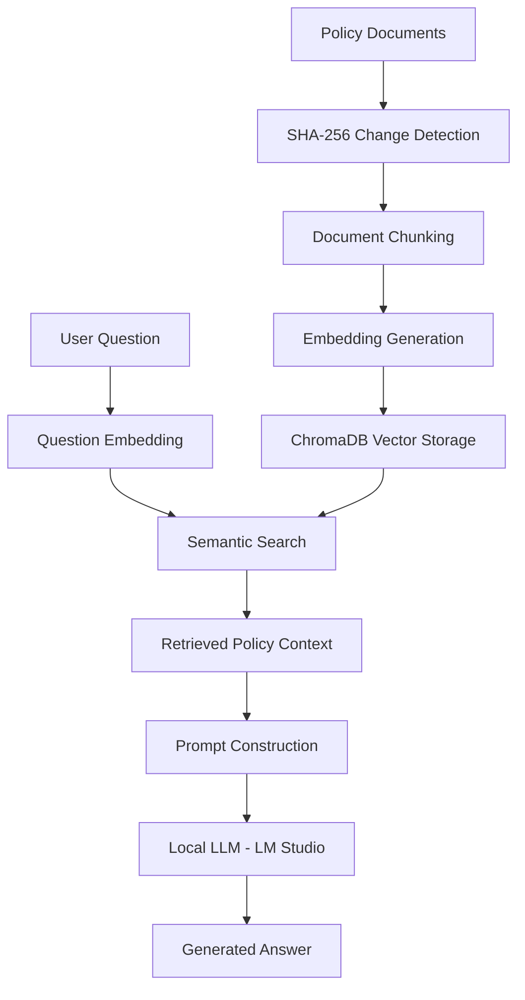

# Policy QA RAG System

An end-to-end **Retrieval-Augmented Generation (RAG)** application that answers natural-language questions about insurance policy documents using semantic search, vector storage, and a locally hosted Large Language Model (LLM).

The application retrieves relevant policy information from documents and uses it as context for generating answers, helping reduce unsupported responses from the language model.

**Key highlights**
- Semantic search using Sentence Transformers.
- Persistent vector storage with ChromaDB.
- Category-based policy retrieval using metadata filtering.
- Local LLM integration using LM Studio.
- Incremental document ingestion using SHA-256 file hashing.
- Context-grounded question answering.

> **Note:** The insurance policies included in this repository are fictional demonstration documents. This project is intended for educational purposes and is not an insurance or legal advice system.

---

## 1. Project Overview

Insurance policies contain important information distributed across different sections, conditions, waiting periods, and exclusions. Finding specific information manually can be time-consuming.

This project demonstrates how a RAG-based application can make policy information easier to access.

Users can ask questions such as:

- When does illness coverage begin?
- What does the motor policy cover?
- Who receives the life insurance death benefit?
- What exclusions are mentioned in the available policies?

The application searches the policy documents, retrieves relevant text passages, and provides them to a language model to generate an answer.

**Primary objective:** Generate clear answers grounded in the supplied policy documents rather than relying entirely on the LLM's general knowledge.

## 2. What Is RAG?

**RAG stands for Retrieval-Augmented Generation.**

It combines two capabilities:

1. **Retrieval:** Finds relevant information from an external knowledge source.
2. **Generation:** Uses a Large Language Model to generate a natural-language response based on the retrieved information.

### Example

Suppose a user asks:

"When does illness coverage begin?"

Instead of relying only on the language model's existing knowledge, the application:

1. Searches the available policy documents.
2. Retrieves the relevant waiting-period information.
3. Sends the retrieved text and question to the language model.
4. Generates an answer using the supplied context.

This approach allows the language model to answer questions about custom documents that were not necessarily part of its original training data.

## 3. System Architecture

The application has two major stages: document ingestion and question answering.

### Overall architecture



### Stage 1: Document Ingestion

Policy documents are:

1. Checked for new, modified, or deleted files.
2. Divided into smaller text chunks.
3. Converted into numerical embeddings.
4. Stored in ChromaDB along with metadata.

### Stage 2: Question Answering

When a user asks a question:

1. The question is converted into an embedding.
2. ChromaDB searches for semantically similar policy chunks.
3. Optional metadata filtering restricts the search to a selected category.
4. Retrieved chunks are combined into context.
5. The context and question are sent to the local language model.
6. The generated answer is displayed to the user.

## 4. Technology Stack

| Technology | Purpose |
|---|---|
| Python 3.11 | Main programming language |
| Sentence Transformers | Generates text embeddings |
| all-MiniLM-L6-v2 | Pre-trained embedding model |
| ChromaDB | Persistent vector storage and retrieval |
| HNSW | Approximate nearest-neighbour indexing used by ChromaDB |
| LM Studio | Runs the language model locally |
| Llama 3.2 3B Instruct | Generates natural-language answers |
| OpenAI Python SDK | Communicates with LM Studio's compatible API |
| SHA-256 | Detects changes in policy documents |
| JSON | Stores previously processed file hashes |
| Git and GitHub | Version control and project hosting |

## 5. Important Technical Concepts

This section provides a study-friendly overview of the concepts implemented in the project.

### 5.1 Document Chunking

Chunking divides a large document into smaller sections called chunks.

Instead of searching an entire policy document as one large text, the application searches smaller sections to identify relevant information.

**Implementation:** `chunker.py`

The current implementation separates text using paragraph boundaries (`\n\n`), removes surrounding whitespace, and ignores empty chunks.

**Why it is useful:**
- Makes individual policy sections easier to retrieve.
- Reduces the amount of irrelevant text supplied to the LLM.
- Allows more focused semantic search.

The current implementation uses paragraph-based chunking rather than token-aware chunking with overlap.

### 5.2 Text Embeddings

An embedding is a numerical representation of text generated by a machine learning model.

Embeddings allow text to be compared mathematically based on semantic similarity.

For example:

- "When does illness insurance start?"
- "What is the waiting period for illness coverage?"

Although the wording differs, these questions have related meanings.

The embedding model helps represent that semantic relationship.

**Model:** `all-MiniLM-L6-v2`

It generates a vector containing 384 numerical values for each input text.

**Implementation:** `embedder.py`

### 5.3 Sentence Transformers

Sentence Transformers is a Python library that provides pre-trained models for generating text embeddings.

This project uses its `SentenceTransformer` class to load `all-MiniLM-L6-v2` and convert policy chunks and user questions into vectors.

It avoids the need to train an embedding model from scratch.

### 5.4 Vector Database and ChromaDB

A vector database stores numerical embeddings and supports similarity-based retrieval.

This project uses ChromaDB to store:

- Policy text chunks.
- Their embedding vectors.
- Unique document identifiers.
- Metadata such as source, category, and chunk index.

The application uses ChromaDB's `PersistentClient`, allowing stored records to remain available between application runs.

ChromaDB also provides insertion, deletion, similarity search, and metadata filtering.

### 5.5 Cosine Similarity

Cosine similarity measures the similarity between two vectors based on the angle between them.

Formula:

```text
Cosine Similarity = (A · B) / (||A|| × ||B||)
```

Where:
- A and B are embedding vectors.
- A · B represents their dot product.
- Their magnitudes are represented by ||A|| and ||B||.

The project configures ChromaDB to use cosine distance:

```python
metadata={"hnsw:space": "cosine"}
```

For cosine distance:

```text
Cosine Distance = 1 - Cosine Similarity
```

A lower cosine distance generally indicates greater semantic similarity.

The application converts the returned distance into a similarity-style score using `1 - distance`. This score is not a probability or guarantee of answer correctness.

### 5.6 HNSW Indexing

HNSW stands for **Hierarchical Navigable Small World**.

It is an approximate nearest-neighbour search algorithm that uses a hierarchical graph structure to navigate between vectors efficiently.

- The bottom layer contains all indexed vectors.
- Higher layers contain progressively fewer selected vectors.
- Search navigates through these layers to find promising candidates.

HNSW reduces the need to compare a query against every stored vector.

**Important:** HNSW is approximate, so it does not guarantee that every search returns the mathematically exact nearest neighbours.

ChromaDB manages the index internally.

### 5.7 Metadata Filtering

Metadata is additional information stored alongside each document chunk.

Example:

```python
{
    "source": "health_policy",
    "category": "Health",
    "chunk_index": 0
}
```

The application uses metadata to identify the original policy file, its category, and the position of the chunk.

For example:

```python
where={"category": "Health"}
```

This restricts retrieval to the Health category.

Categories are assigned using a Python mapping in `main.py`. They are not automatically inferred by ChromaDB.

### 5.8 Top-K Retrieval

Top-K controls how many matching chunks the application requests from ChromaDB.

For example:

```python
top_k=4
```

requests up to four matching chunks.

A smaller value provides less context, while a larger value may provide additional information but can also introduce irrelevant text.

Top-K controls the number of results returned, not the amount of work performed internally by HNSW.

### 5.9 Large Language Models

A Large Language Model (LLM) is a machine learning model trained to understand and generate human language.

In this project, the LLM receives:

- The user's question.
- Retrieved policy text.
- Instructions describing how to generate an answer.

Its responsibility is to produce a clear response grounded in the supplied context.

### 5.10 LM Studio and Local LLM Integration

LM Studio allows users to download and run compatible language models locally.

This project uses:

**Llama 3.2 3B Instruct**

LM Studio exposes an API compatible with the OpenAI API format. The Python application communicates with it through the OpenAI Python SDK.

Example configuration:

```python
self.client = OpenAI(
    base_url="http://localhost:1234/v1",
    api_key="lm-studio"
)
```

The API key shown here is a local placeholder, not a real OpenAI API key.

Local inference keeps model execution on the local machine, although sufficient memory and processing resources are still required.

### 5.11 Prompt Engineering

Prompt engineering means designing instructions that guide a language model's behaviour.

The `llm.py` module defines a system prompt that instructs the model to:

- Use the supplied policy context.
- Avoid inventing policy conditions or benefits.
- Handle missing information honestly.
- Explain conflicting information.
- Generate concise, professional answers.

The implementation also uses a low temperature (`0.1`) to encourage more predictable responses.

These instructions help reduce unsupported answers but cannot guarantee factual accuracy.

### 5.12 SHA-256 Hashing and Incremental Ingestion

SHA-256 is a cryptographic hashing algorithm that generates a fixed-length fingerprint from input data.

This project uses SHA-256 to detect changes in policy documents.

The calculated hashes are stored in:

`metadata/policy_hashes.json`

During application startup:

- **New file:** The policy is processed and stored.
- **Modified file:** Its existing chunks are replaced with updated chunks.
- **Unchanged file:** Ingestion is skipped.
- **Deleted file:** Its stored chunks and hash entry are removed.

This approach is called **incremental ingestion** because only new or changed documents need to be processed again.

## 6. Project Structure

```text
Policy-QA-RAG-System/
│
├── data/
│   └── policies/
│       ├── health_policy.txt
│       ├── motor_policy.txt
│       └── life_policy.txt
│
├── metadata/
│   └── .gitkeep
│
├── src/
│   ├── main.py
│   ├── chunker.py
│   ├── embedder.py
│   ├── retriever.py
│   ├── vector_store.py
│   ├── llm.py
│   └── test_llm.py
│
├── tests/
│
├── .gitignore
├── requirements.txt
└── README.md
```

### Module Responsibilities

| File | Responsibility |
|---|---|
| `main.py` | Application entry point, ingestion, user interaction, and RAG orchestration |
| `chunker.py` | Splits policy documents into smaller chunks |
| `embedder.py` | Generates embeddings using Sentence Transformers |
| `vector_store.py` | Manages ChromaDB storage, search, filtering, and deletion |
| `retriever.py` | Earlier standalone NumPy-based cosine similarity implementation |
| `llm.py` | Connects to LM Studio and generates answers |
| `test_llm.py` | Manually tests LLM answer generation |

**Implementation note:** The current main application performs semantic retrieval directly through ChromaDB. The standalone `retriever.py` module is retained as an earlier implementation and is not used in the current main RAG workflow.

## 7. Installation and Setup

### Prerequisites

- Python 3.11
- Git
- LM Studio
- A compatible locally downloaded language model

### Step 1: Clone the repository

```powershell
git clone https://github.com/Subrat78989789/Policy-QA-RAG-System.git
```

Navigate into the project:

```powershell
cd Policy-QA-RAG-System
```

### Step 2: Create a virtual environment

```powershell
py -3.11 -m venv .venv
```

Activate it:

```powershell
.\.venv\Scripts\Activate.ps1
```

A virtual environment isolates the project's Python dependencies from other projects.

### Step 3: Install dependencies

```powershell
python -m pip install --upgrade pip
pip install -r requirements.txt
```

### Step 4: Configure LM Studio

1. Install and open LM Studio.
2. Download a compatible instruction-tuned model.
3. Load the model.
4. Start the local API server.
5. Confirm that the server is listening at:

```text
http://localhost:1234/v1
```

The model identifier in `src/llm.py` must match the identifier exposed by the LM Studio server.

Update `self.model` if the identifier differs.

### Step 5: Run the application

From the project root:

```powershell
python src/main.py
```

On the first run, Sentence Transformers may download the embedding model. Allow the download to complete before asking questions.

## 8. Example Usage

The application supports three policy categories and an option to search across all categories.

| Category | Example question |
|---|---|
| Health | When does illness coverage begin? |
| Health | What is the hospitalization eligibility condition? |
| Health | Are cosmetic procedures covered? |
| Motor | What third-party liabilities are covered? |
| Motor | Is driving without a valid licence covered? |
| Life | Who receives the death benefit? |
| All | What exclusions are mentioned in the available policies? |

### Example interaction

```text
POLICY QA ASSISTANT

Policy QA Assistant is ready!
Type 'exit' to close the application.

Enter your policy question:
When does illness coverage begin?

Enter category (Health/Motor/Life/All):
Health
```

Example answer:

```text
Illness coverage begins after the initial
30-day waiting period from the policy start date.
```

The answer is based on the fictional health policy document supplied to the system.

## 9. Design Decisions

| Decision | Reason |
|---|---|
| Sentence Transformers | Generates semantic embeddings using a pre-trained model |
| ChromaDB | Provides persistent vector storage and similarity search |
| Cosine distance | Measures similarity between embedding vectors |
| Metadata filtering | Supports category-specific policy retrieval |
| LM Studio | Enables local language model inference |
| SHA-256 hashing | Detects document changes and avoids unnecessary reprocessing |
| Model initialization at startup | Avoids repeatedly loading models for every question |

## 10. Current Limitations

This is a learning and demonstration project, not a production-ready insurance decision system.

Current limitations include:

- Policy documents contain fictional sample data.
- Chunking is paragraph-based and does not use token-aware chunk sizes or overlap.
- Policy categories are assigned through a manually maintained Python mapping.
- Retrieval quality depends on document quality, embeddings, and search configuration.
- HNSW retrieval is approximate.
- The language model may still generate incorrect answers despite grounding instructions.
- Generated answers do not yet include formal document or page-level citations.
- No web interface or user authentication is implemented.
- Automated retrieval and answer-quality evaluation is not yet implemented.
- The application has not been validated for real insurance or legal decision-making.

## 11. Future Improvements

Potential enhancements include:

- Build a graphical interface using Streamlit or FastAPI.
- Implement token-aware chunking with overlap.
- Add source references and document-level citations to answers.
- Improve retrieval using reranking.
- Add automated retrieval and answer evaluation.
- Implement unit and integration tests.
- Support PDF and DOCX policy documents.
- Improve error handling and ingestion recovery.
- Make retrieval parameters configurable.
- Support additional policy categories.

## 12. Learning Outcomes

This project demonstrates practical implementation of:

- Retrieval-Augmented Generation architecture.
- Semantic search and text embeddings.
- Sentence Transformers.
- Vector databases and ChromaDB.
- Approximate nearest-neighbour search.
- Metadata-based retrieval filtering.
- Prompt engineering and LLM integration.
- Local language model inference.
- Persistent data storage.
- Incremental document ingestion.
- SHA-256 file hashing and change detection.
- Modular Python application design.
- Git and GitHub version control.

## 13. Author

**Subrat**

GitHub: https://github.com/Subrat78989789

---

*Developed for educational purposes to explore the practical implementation of Retrieval-Augmented Generation using insurance policy documents.*